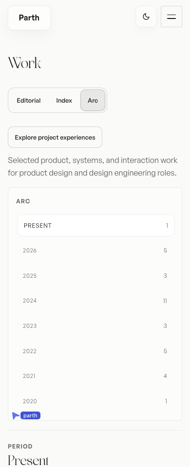
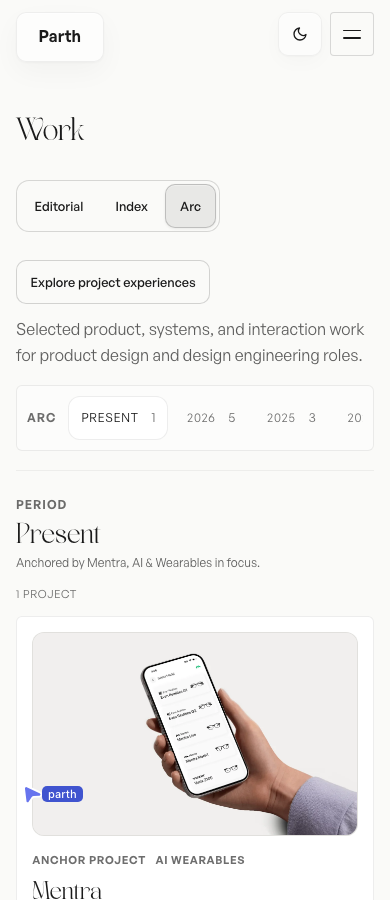
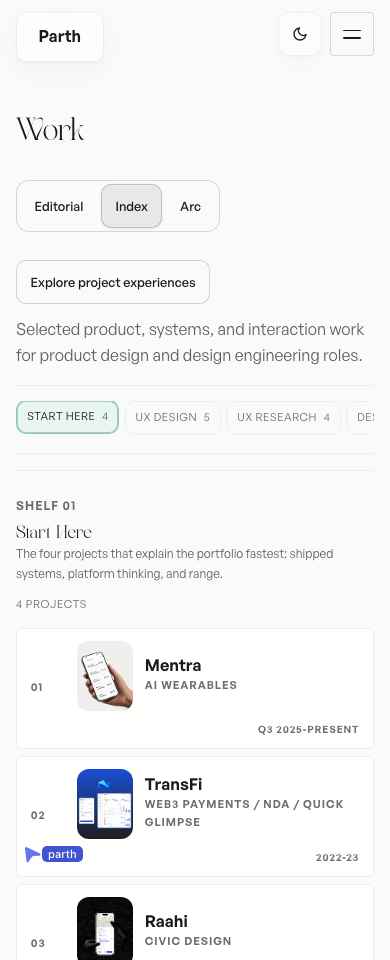
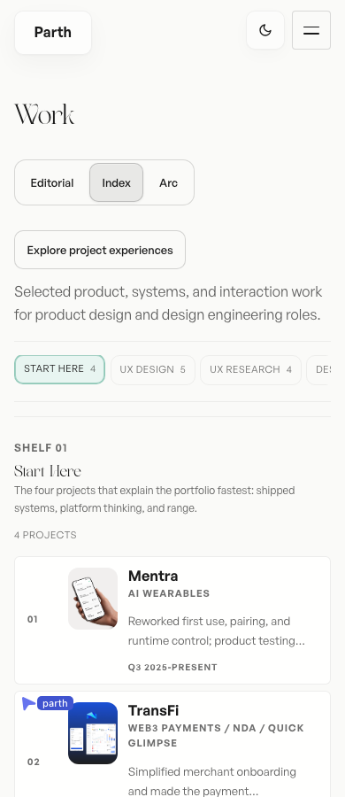
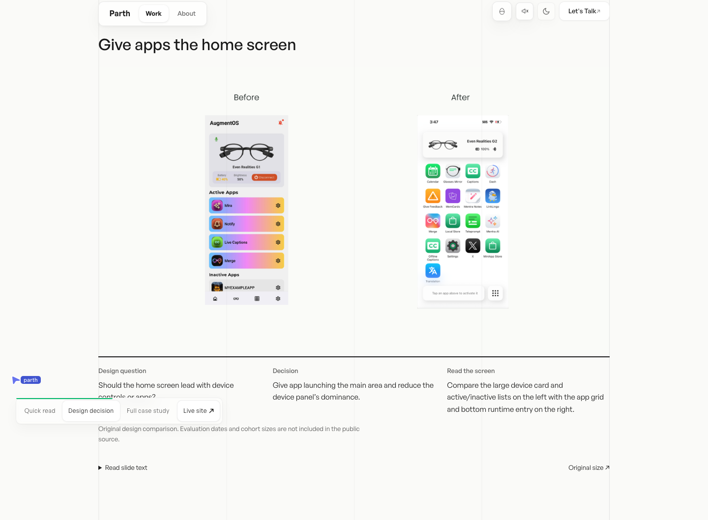
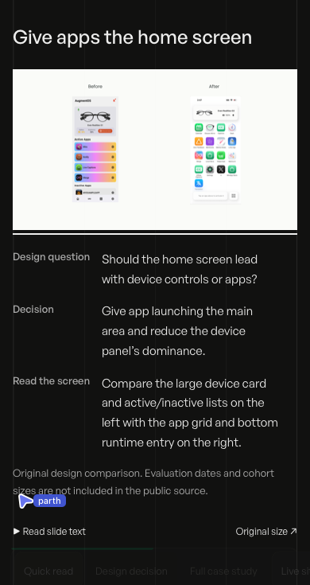

# Work browsing and Mentra proof

Local review, 17 October 2026. Based on main at `4258756e570fa91c8dde723d656cc192199911ea`. Prepared for pull-request review. No merge, deployment, or approval-status change.

## Changes

- Deduplicate the Work catalogue by project slug before building Arc and category shelves. Jugalbandi now appears once in 2024, and period counts match the displayed projects.
- Replace the mobile Arc period stack with one horizontally scrollable row. Keyboard focus reveals offscreen periods; touch selection remains available.
- Restore the two-line description between the project identity and date in mobile Index rows.
- Preserve the originating Work view and filter through native case-study chapter anchors. Native fragment history entries can share React Router’s `default` key; that key is no longer cached as a unique return destination. Direct visits retain the `/work` fallback.
- Add one original Mentra comparison to Quick read. Figma source node `6:28341`, existing asset `public/Assets/case-study-slides/mentra/slide-6-28341.webp`, compares a device-led home screen with the later app-led screen. The existing reader supports enlargement, original-size viewing, keyboard access, and retry. The full 44-slide archive stays deferred.
- State the source limitation beside the comparison: evaluation dates and cohort sizes are absent from the public source. No interfaces, measurements, or research evidence were invented.

## Before and after

Measurements use a 390 × 900 Chromium viewport, light theme, reduced motion, and decorative WebGL disabled to isolate layout.

| Check | Before | After |
| --- | --- | --- |
| Arc period navigation height | 479.8 px | 66 px |
| First Arc project top | 1029.3 px | 615.5 px |
| Jugalbandi entries in 2024 | 2 | 1 |
| Index project description on mobile | Hidden | Visible |
| Return after Overview fragment navigation | Falls back to `/work` | Keeps originating view and filter |
| Original comparison in Mentra Quick read | None | One original source slide |








Interaction recording: [mobile Work and Mentra navigation](mobile-interaction.webm).

## Verification

- Production build and TypeScript pass. Design-system audit has no blocking failures; existing stylesheet-refactor warnings remain. Scoped design detector returns no findings.
- Work/proof regression: 7/7 profiles pass, covering Chromium at 1440, 768, 390 and 320 px and WebKit at 1440 and 390 px, with light/dark themes, keyboard enlargement and focus return, touch period selection, history navigation, preserved filters, direct links, source request boundaries, and no horizontal document overflow.
- Original-slide regression: 8 responsive/theme cases pass. All 44 Mentra source slides and 3 public TransFi slides remain accessible through their intended readers; protected reviewer content remains gated. Keyboard preview, lazy loading, old deep links and image retry pass.
- Startup: 18/18 cases pass. Chromium measured maximum CLS 0; WebKit first-frame geometry checks pass. This isolates page geometry, not a new full WebGL or network-speed benchmark.
- Cover lifecycle investigation: the expanded final suite passes 52/52 cases across Chromium/WebKit and both themes, including seven-second module delays, failed-module fallback, project navigation, rapid selection, offscreen disposal, keyboard dismissal, mobile entry and reduced motion. The original investigation began when 43/44 cases passed in the earlier run. WebKit desktop light rapid-selection did not bind/start its preview within the existing 8-second assertion. One isolated reproduction passed with the same deadline and playback assertions, showing loaded Raahi screens followed by an advancing Mentra film. The first failure is retained in `cover-lifecycle-results.json`; its cause is not established. No cover-runtime change or weakened assertion was made to hide it. Trace and screenshot remain at `/tmp/work-proof-path-review/cover-regression/FAIL-webkit-1440-light-rapid-selection.*`.
- Source guards confirm Shuffle, footer sources, experience approvals and protected-content boundaries are unchanged. The unfinished footer checkout on port 5222 was not edited.

The focused Work/proof regression is included in the existing pull-request workflow. Hosted CI results are recorded in the pull request. See [the WebKit investigation](WEBKIT-TIMEOUT.md) for the retained failure and the added loading checks.

## Reproduce locally

```sh
QA_BASE_URL=http://127.0.0.1:5236 node scripts/work-proof-path-qa.mjs
QA_BASE_URL=http://127.0.0.1:5236 QA_CASE_STUDY_PUBLIC_ONLY=1 node scripts/case-study-slides-qa.mjs
QA_BASE_URL=http://127.0.0.1:5236 node scripts/cover-startup-qa.mjs
```

Review routes: `/work?view=timeline`, `/work?view=library`, and `/mentra#cs-design-proof`.
